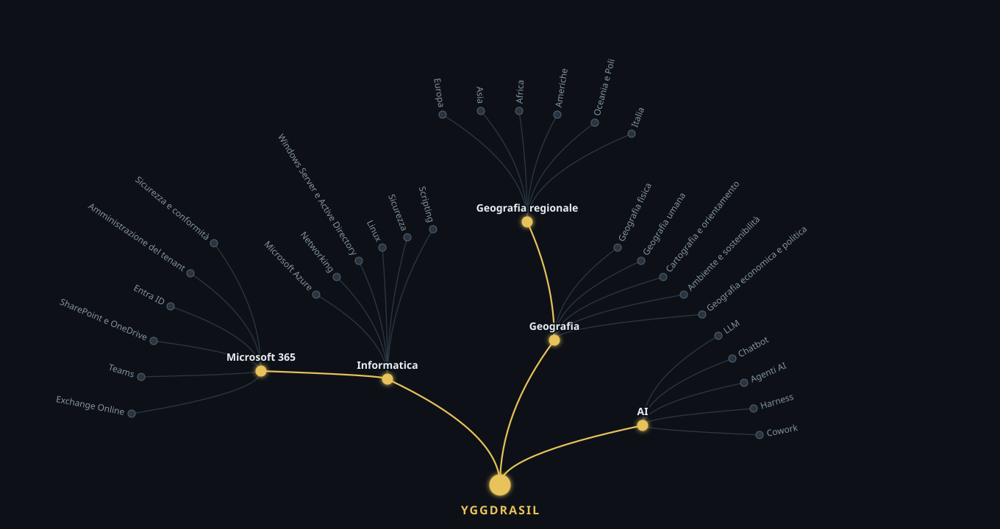

# YggdraSkill

A gamified skill-tree web app. Skills are branches of a tree: you unlock a branch by passing an entry test, then climb from Novice to Master through **open-ended assessments graded by AI**. New sub-branches are generated by AI as you progress. Runs as a Telegram Mini App.

> **About this repository.** This is a public showcase: architecture, design choices and a few selected source files. The full source code is kept private and can be walked through in an interview. Code comments are in Italian, my working language for this project.

## What it does
- **Interactive skill tree.** Locked branches stay "in the fog"; passing an entry test reveals them and their sub-branches.
- **AI-generated growth.** When a branch is unlocked, AI proposes 3-6 sub-branches, merges duplicates into the existing graph and builds a question bank for each one.
- **AI-graded assessments.** Level-up exams with open answers: AI scores each answer 0-10 with feedback; pass/fail is decided by code (average ≥ 6, no answer below 4), not by the model.
- **Spaced review.** Skills not practised for a while "rust" and ask for a short review.
- **Secure Telegram login.** Mini App `initData` verified with HMAC-SHA256, data freshness and user allow-list.
- **Operations.** Isolated multi-instance setup, automatic HTTPS, nightly backups with rotation and tested restore, daily AI usage cap per user.

## Tech stack
Python · Starlette · SQLite · Telegram Mini App (WebApp API) · Claude (Anthropic) · Caddy (automatic HTTPS) · systemd · JavaScript / SVG

## Selected code
| File | What it shows |
|---|---|
| [`excerpts/esame.py`](excerpts/esame.py) | AI-graded open-ended exams with code-enforced pass rules |
| [`excerpts/nebbia.py`](excerpts/nebbia.py) | AI generation of new sub-branches with de-duplication |
| [`excerpts/accesso.py`](excerpts/accesso.py) | Telegram Mini App authentication (HMAC-SHA256) |

---
William Cuccovillo · [LinkedIn](https://www.linkedin.com/in/william-cuccovillo-7078aab1/)
